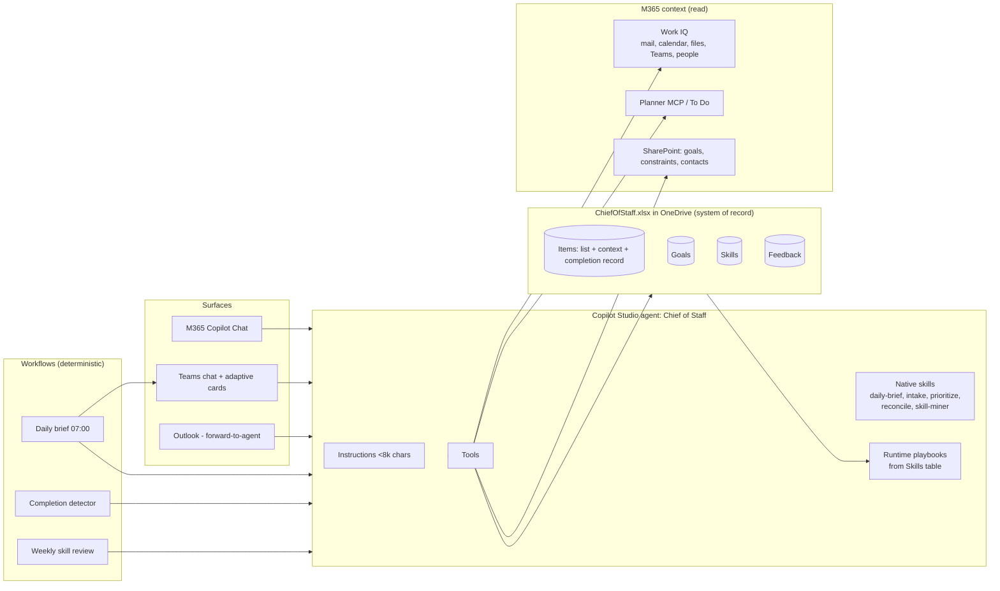

# 02 — Architecture

**Status:** Draft v0.1 (2026-10-29)

---

## 1. Platform choice

**Recommendation:** Build a Copilot Studio agent on the GitHub Copilot harness (GA as of Aug 2026), publish it to Microsoft 365 Copilot and Teams, and store the list in an Excel workbook in OneDrive (ADR-006).

| Option | Verdict | Why |
|--------|---------|-----|
| **Copilot Studio agent (harness) → M365 Copilot + Teams** | **Chosen** | Native skills (SKILL.md), MCP and workflow tools (GA), recurrence and event triggers, Excel connector, Work IQ (preview), model choice (incl. Claude Sonnet 5, GPT-5.5). Low-code, so it can be iterated fast. |
| Declarative agent (Agents Toolkit) | Not chosen | Good for chat-only use. Has no triggers or scheduled runs, so it can't build the brief at 07:00 or detect completions. |
| Custom engine (M365 Agents SDK / Foundry) | Fallback | Full control, but you own hosting, auth, and ops. Worth it only if Copilot Studio limits block a core job. |

The full rationale is in [06-decisions.md](06-decisions.md), ADR-001.

## 2. Component map

## 3. Responsibilities

| Layer | Owns | Notes |
|-------|------|-------|
| **Instructions** | Identity, guardrails, priority rubric summary, when to use which skill | Under 8k chars. Never holds procedures. |
| **Native skills** | Procedures for recurring jobs (J1–J5) | Authored as SKILL.md in `m365/skills/`, zipped by `scripts/skills.py`, imported into Copilot Studio. Versioned in git. |
| **Runtime playbooks** | New, unproven skills generated from usage | Rows in the Skills table (Tier=playbook). The agent looks them up at runtime. Approval makes them live with no republish. |
| **Tools** | Data access and side effects | Excel Online (Business): list/get/add/update rows; Work IQ (read); Outlook/Teams (draft only, confirmation required); Planner MCP (optional mirror) |
| **Workflows** | Anything that must run on time or deterministically | Recurrence and event triggers. They call the agent through the "Microsoft 365 Copilot / agent" node or run fixed steps. |
| **Workbook** | Durable state and history | Single source of truth, readable by you in Excel. Planner/To Do are optional mirrors only. |

## 4. Core flows

### 4.1 Daily brief (J1)
1. Recurrence at 07:00 (workdays, user TZ) → workflow loads open items, today's calendar, and active goals.
2. Workflow invokes the agent with `daily-brief` context.
3. Agent: re-scores items with `prioritize`, fits them into free calendar blocks, picks Top 3, and lists drop/delegate candidates.
4. Writes DoDate and PlannedSlot back to the planned Items rows and posts an adaptive card to Teams (Accept / Edit / Re-plan).
5. Card response → Feedback row (accept/edit), so brief quality is measurable.

### 4.2 Intake (J2, J3)
1. User: "Add: prep pricing review for Contoso renewal".
2. `intake` skill: dedupe against open items → search Work IQ for related mail, meetings, files, and people → add an Items row with SourceLink, ContextLinks, People, and ResearchNotes.
3. `prioritize` skill: score with the rubric, suggest due/do dates, state the tradeoff against today's Top 3.
4. Reply: one-line summary, score breakdown, links, proposed slot. Ask at most one clarifying question.

### 4.3 Reconcile (J4)
1. Trigger: user says done, the Planner task completes (mirror), or the detector finds evidence (a reply sent on a linked thread, a linked meeting ended, a linked file modified).
2. `reconcile` skill: gather evidence via links → fill the row's completion columns (outcome, decisions, artifacts, time, steps, signature) → update goal progress → create follow-up items → ask "Mark complete?" if triggered by detection.
3. Steps and signature feed the skill miner.

### 4.4 Skill generation (J5, J6)
See [04-skill-lifecycle.md](04-skill-lifecycle.md).

## 5. Security and guardrails

- **No autonomous sends.** Send-mail and post-message tools are configured with "ask user for confirmation". Instructions repeat the guardrail.
- **Least privilege.** Delegated (user) auth for M365 data, so the agent sees only what the user can. No application permissions.
- **Confidentiality.** Keyword triggers from CLAUDE.md §1.5 (fundraising, M&A, PIP, legal…) cause the agent to flag sensitivity, skip writing summaries into the workbook, and store only reference links.
- **Entra Agent ID** is created automatically (July 2026+), so audit trails attribute actions to the agent.
- **Data residency.** Everything stays in the tenant (your OneDrive + M365). No external services in v1.

## 6. Known platform risks

| Risk | Impact | Mitigation |
|------|--------|-----------|
| Work IQ still preview / not enabled by IT | Weaker context gathering | Fall back to Office 365 Outlook, Teams, and SharePoint connectors |
| No API to create native skills | Skill generation can't fully auto-deploy | Two-tier design: playbooks go live at runtime, native skills via repo + manual import |
| Per-tool MCP blocking not available (block whole server only) | IT may block an MCP server outright | Keep each MCP dependency optional; core loop runs on the Excel + Outlook connectors |
| Copilot Credit consumption from triggers | Cost visibility | Cap at ~4 scheduled runs/day; report runs in weekly review |
| Instruction and context limits | Behavior drift | Keep instructions lean and move detail to skills (loaded on demand) |
| Excel connector limits (one filter per column, 30 s write lag, 6 min lock, no concurrent desktop edits) | Stale reads, write conflicts | `Open` column for single-filter queries; one batched write per flow; edit via the agent or Excel for the web (03-data-model.md) |
