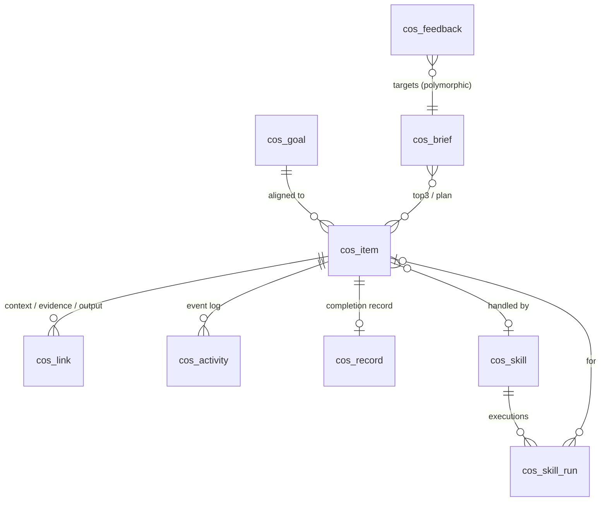

# 03 — Data Model

**Status:** Draft v0.1 (2026-10-29)
**Definitions:** [`../schema/dataverse-tables.yaml`](../schema/dataverse-tables.yaml) is the source of truth. This page explains how the tables fit together.

## Design notes

- **Items are the unit of work.** The daily list is a view over `cos_item` (status in triaged/scheduled/in_progress/waiting, ordered by `priority_score`). The brief snapshots that view into `cos_brief`.
- **Links make items actionable.** Every item should have at least one `cos_link`, either its `source` (the email or chat it came from) or `context` (related meetings, files, people). `web_url` is for the user. `graph_id` lets the agent re-fetch fresh content.
- **Records are permanent.** `cos_record` is written once at reconcile and never edited. Corrections become new `cos_feedback` rows. This keeps the mining input honest.
- **Signature is the mining key.** Format: `verb|object|counterpart`, lowercase and kebab-case, e.g. `prepare|pricing-review|customer`, `send|weekly-status|leadership`, `review|contract|legal`. The reconcile skill picks from existing signatures before minting a new one, which keeps the vocabulary small.
- **Activity is append-only.** Use it for time accounting (`minutes`) and as a backup source for `steps`.
- **Confidential items** (`confidential=true`) store titles and links only. Research notes, outcomes, and decisions stay empty, and the user is reminded where the details live.

## Mapping from the Claude Code kit

| Root kit file | M365 equivalent |
|---------------|-----------------|
| `goals.yaml` | `cos_goal` (one-time import; edit in Dataverse or keep yaml as source and sync) |
| `my-tasks.yaml` | `cos_item` |
| `contacts/*.md` | Phase 4: `cos_contact`, or use people context from Work IQ |
| `schedules.yaml` | Copilot Studio triggers / workflows (`m365/flows/`) |
| `commands/*.md` | `m365/skills/*/SKILL.md` |
