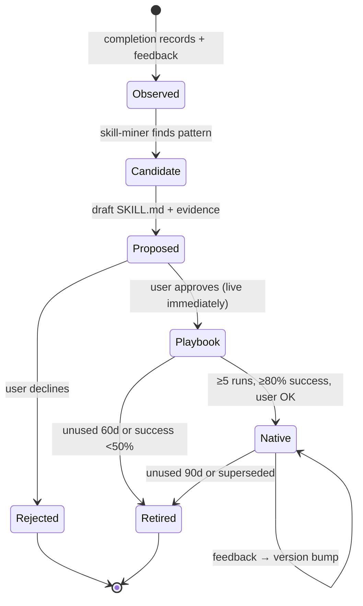

# 04 — Skill Lifecycle (self-improving loop)

**Status:** Draft v0.1 (2026-10-29)

The agent gets better in two ways: it **generates new skills** from repeated work, and it **refines existing behavior** from feedback. Both feed into a single pipeline with a human approval gate.

---

## 1. Lifecycle



| Stage | Where it lives | Who acts | Exit criteria |
|-------|----------------|----------|---------------|
| Observed | `cos_record.steps`, `cos_record.signature`, `cos_feedback` | Reconcile skill, feedback logging | — |
| Candidate | Skill-miner working set | Weekly skill review workflow | Pattern meets the thresholds below |
| Proposed | `cos_skill` (status=proposed) | Agent drafts; user reviews in chat or card | User approves or rejects |
| Playbook | `cos_skill` (tier=playbook, status=active) | Agent loads via `get_playbook` tool | Graduation thresholds |
| Native | `m365/skills/<name>/SKILL.md` → imported into Copilot Studio | User merges PR and imports zip | Version bumps on feedback |
| Retired | `cos_skill` (status=retired) | Weekly review | — |

## 2. Signals the agent records

1. **Completion records** (`cos_record`): a normalized `signature` (verb + object type + counterpart type, e.g. `prepare|pricing-review|customer`) and an ordered `steps` list (tools used, artifacts touched, minutes).
2. **Skill runs** (`cos_skill_run`): outcome (success/partial/fail), number of user edits, and estimated minutes saved.
3. **Feedback** (`cos_feedback`): accept/edit/reject on briefs, items, and drafts. Explicit corrections ("always CC my manager on pricing") are stored verbatim.
4. **Recurrence hints**: the same item title pattern on the same weekday or monthly cadence.

## 3. Mining thresholds (initial — tune after Phase 3)

A pattern becomes a **candidate** when any of these hold over a rolling 30 days:

| Rule | Threshold |
|------|-----------|
| Same signature completed | ≥3 times |
| Same signature, avg handling time | ≥20 min and ≥2 occurrences |
| Fixed cadence detected (weekly/monthly) | ≥2 cycles |
| Same correction repeated | ≥2 times → **instruction/skill patch** proposal, not a new skill |

Candidates are ranked by `frequency × avg_minutes × automation_fit` (automation_fit 0–1: how many steps are tool calls vs. judgment calls).

## 4. Proposal format

Every proposal shown to the user contains:

```
SKILL PROPOSAL: <name>                                   [approve / edit / reject]
Pattern:   <signature> — seen <n>x in 30d, avg <m> min
Evidence:  <links to 3 most recent cos_record rows>
Saves:     ~<x> min/run, ~<y> min/month
Draft:     <SKILL.md, collapsed>
Risks:     <judgment steps that stay manual; data touched; anything it sends (drafts only)>
```

The draft follows [skills/_template/SKILL.md](../skills/_template/SKILL.md) and must pass `scripts/skills.py validate`.

## 5. Two tiers, and why

Copilot Studio skills are imported through the UI, and no create/update API is documented (as of 2026-10). Waiting for a manual import would stall the feedback loop, so:

- **Tier A — Playbook (runtime).** On approval, the SKILL.md body is stored in `cos_skill.body`. The agent's instructions say: *before starting a task, call `find_playbook(signature)`; if one is active, follow it.* It goes live immediately with no republish.
- **Tier B — Native skill.** Once a playbook proves itself (≥5 runs, ≥80% success, the user agrees), the agent exports it. The user (or Claude Code in this repo) commits it to `m365/skills/<name>/` via PR, CI validates it, `scripts/skills.py package` builds the zip, and the user imports it. Native skills get on-demand loading and travel with the agent through solutions/ALM.

If Copilot Studio later exposes a skills API, Tier B import becomes a workflow step and Tier A remains as the staging area.

## 6. Feedback → behavior changes

| Feedback type | Action |
|---------------|--------|
| One-off edit to a draft/brief | Log only |
| Same correction ≥2× | Propose a patch (≤10 lines) to the relevant skill or the instructions; user approves (mirrors CLAUDE.md Part 9) |
| Skill run rated fail/partial | Log in `cos_skill_run`; 3 fails in 10 runs → propose revision or retirement |
| Brief rejected | Ask one question: "What was wrong — ranking, missing item, or timing?" Log the answer |

## 7. Guardrails on generated skills

- Generated skills may **draft** but never **send**, accept meetings, or delete data.
- A skill touching confidential keywords (CLAUDE.md §1.5) is flagged in its proposal and stores references only.
- No skill is activated without explicit user approval. No silent self-modification.
- Each skill declares the tools it expects. The agent refuses to run it if a tool is unavailable, rather than improvising.
